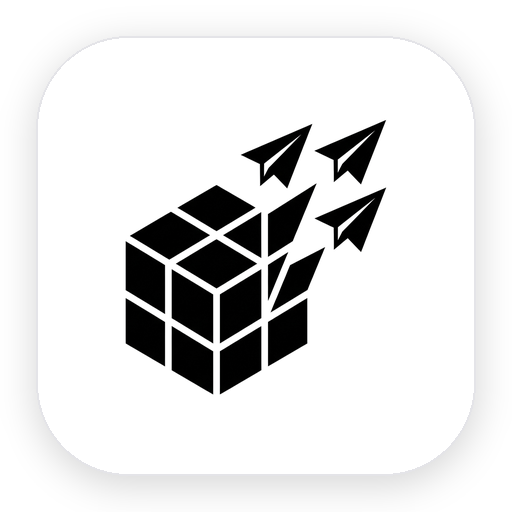

<p align="center">
  
</p>

<p align="center">
  
</p>

<p align="center">
  <strong>Turn 10 free Google Colab accounts + your Mac into one live Blender GPU fleet. Just run <code>blendfleet fly</code>.</strong>
</p>

<p align="center">
  <a href="https://github.com/brixtonpham/blendfleet/releases"></a>
  <a href="https://www.python.org/"></a>
  <a href="LICENSE"></a>
  <a href="pyproject.toml"></a>
  <a href="https://colab.research.google.com/github/brixtonpham/blendfleet/blob/main/notebooks/blendfleet_worker.ipynb"></a>
</p>

<p align="center">
  <strong>English</strong> | <a href="README.vi.md">Tiếng Việt</a> | <a href="README.zh-CN.md">简体中文</a>
</p>

<p align="center">
  <strong>blendfleet</strong> pools free and paid Google Colab GPUs (<code>T4</code>, <code>L4</code>, <code>G4</code>), Kaggle GPUs, and your local Apple Silicon or NVIDIA machine into one persistent <code>bpy</code> work-stealing render pool.<br />
  Log in once per Google account, then run headless multi-GPU renders from your terminal — with zero per-frame Blender restarts and zero external core dependencies.
</p>

---

## Install

```bash
# 1. Core CLI (zero Python runtime dependencies)
uv tool install git+https://github.com/brixtonpham/blendfleet.git

# 2. Optional: headless multi-account Colab fleet + tunnel
uv tool install google-colab-cli && brew install cloudflared

# 3. Optional: install the official Agent Skill (Claude Code / Cursor / Codex / Antigravity)
npx skills add brixtonpham/blendfleet
```

<details>
<summary>Alternative install with <code>pip</code></summary>

```bash
pip install git+https://github.com/brixtonpham/blendfleet.git
```

</details>

---

## Login Once → Fly Forever

Register each Google account once — credentials stay local in `~/.config/blendfleet/accounts/` (`0600`) — and dispatch multi-account Colab GPU fleets from your terminal with zero browser tabs to babysit.

### 1. Register your Google accounts once

```bash
# Inspect your local Chrome profiles (optional)
blendfleet account chrome-profiles

# Authenticate each account once (opens the matching Chrome profile)
blendfleet account add acc1 --chrome-profile "Profile 1"
blendfleet account add acc2 --chrome-profile "Profile 2"
blendfleet account add acc3 --chrome-profile "Profile 3"
```

### 2. Check all accounts & CCU balances in parallel

```bash
blendfleet account check
```

Verifies every stored account's email, token freshness, and available Colab Compute Units (CCU) concurrently before you start a render.

### 3. Launch the fleet in one command

```bash
blendfleet fly scene.blend \
  --frames 1-240 \
  --out ./out \
  --accounts all \
  --gpu T4 \
  --local-workers 1 \
  --stitch-out final.mp4
```

What `blendfleet fly` does automatically:
1. Starts the local HTTP work-stealing coordinator and opens a `cloudflared` Quick Tunnel with an ephemeral bearer token.
2. Spawns headless Colab GPU runtimes across every selected account (`--accounts all` or `--accounts acc1,acc2`) and attaches your local GPU (`--local-workers 1`).
3. Streams `scene.blend` once per worker, keeps one persistent `bpy` process alive per GPU, reclaims frames if any Colab VM disconnects, validates PNG/EXR headers atomically, tears down Colab VMs cleanly on exit, and stitches `final.mp4` via hardware-accelerated FFmpeg.

---

## Agent Skill

`blendfleet` ships with an official Agent Skill at [`skills/blendfleet/SKILL.md`](skills/blendfleet/SKILL.md) for Claude Code, Antigravity, Codex, OpenCode, and Cursor.

### Install the Skill

```bash
# Universal installer (Claude Code, Cursor, Codex, Antigravity, OpenCode)
npx skills add brixtonpham/blendfleet

# Or with ccp (https://github.com/samhvw8/claude-code-profile)
ccp install https://github.com/brixtonpham/blendfleet --all --link .

# Or copy directly into your agent skills directory
git clone --depth 1 https://github.com/brixtonpham/blendfleet.git ~/.cache/blendfleet-repo \
  && cp -R ~/.cache/blendfleet-repo/skills/blendfleet ~/.claude/skills/blendfleet \
  && rm -rf ~/.cache/blendfleet-repo
```

### Example Prompts

- *"Check my blendfleet Colab accounts and CCU balances, then render frames 1–240 of `shot_03.blend` across all free T4s plus my Mac and stitch at 24fps."*
- *"Discover my Chrome profiles, help me add 3 Google accounts to blendfleet, and verify them."*
- *"Verify `./renders/shot_03` has all 240 frames intact, re-render any missing frames on Colab L4, and stitch `shot_03.mp4`."*

---

## How It Works

```text
                      ┌──────────────────────────────────────────┐
                      │       blendfleet fly / serve --tunnel     │
                      │  • Serves .blend once (SHA-256 cached)   │
                      │  • Dynamic frame leases + heartbeats     │
                      │  • Auto-reclaims frames from dead VMs    │
                      │  • Atomic PNG/EXR validation -> ./out    │
                      │  • Auto-stitches MP4 on completion       │
                      └──────┬─────────────┬─────────────┬───────┘
                             │             │             │
                localhost    │   HTTPS     │   HTTPS     │   HTTPS
                             ▼             ▼             ▼
                   ┌──────────────┐ ┌────────────┐ ┌────────────┐
                   │ Local Worker │ │ Colab acc1 │ │ Colab 2..N │
                   │ Apple M3 Max │ │ Free T4    │ │ T4 / L4/G4 │
                   │ Metal RT     │ │ OptiX      │ │ OptiX      │
                   │ 1x bpy proc  │ │ 1x bpy proc│ │ 1x bpy proc│
                   └──────────────┘ └────────────┘ └────────────┘
```

### 20× Faster Warm Frames (Zero Per-Frame Restarts)

Measured on **Blender 5.2.3 LTS**:
- **Cold startup per frame** (legacy `blender -b` loop): **`1.44s–8.58s`** spent reloading `.blend`, unpacking textures, and rebuilding BVH/OptiX shader caches on every frame.
- **Persistent `bpy` loop** (`blendfleet`): **`0.33s`** warm frames — up to **20× lower frame overhead**, because each worker launches Blender **once** (`blender -b scene.blend -P blender_worker.py`) and pulls frames back-to-back in memory.

### Comparison vs Legacy Colab Blender Notebooks

| Capability | Legacy Colab Notebooks | `blendfleet` |
|---|---|---|
| Blender process lifecycle | Restarts `blender -b` every frame (`1.44s–8.58s` tax) | **Persistent `bpy` loop** (`0.33s` warm frames) |
| Multi-account execution | Manual browser tabs + Drive OAuth clicks per session | **Login once → `blendfleet fly --accounts all`** |
| Frame distribution | Static range splits (fast GPUs sit idle) | **Dynamic work-stealing** with TTL leases + heartbeats |
| Shared Drive lock races | `.tmp` file races across 2–10s Drive FUSE sync lag | **HTTP coordinator** (or 2-phase modulo + `O_CREAT\|O_EXCL`) |
| Disconnect / 90-min timeout | Orphaned frames require manual re-runs | **Automatic stale-lease reclamation** + atomic PNG/EXR checks |
| Core Python dependencies | Heavy notebook pip installs that break Colab pins | **0 external dependencies** (100% Python stdlib core) |

### GPU Selection Matrix for Blender Cycles

Cycles relies on **hardware Ray Tracing cores** (`OPTIX` / `METAL`), not Tensor cores:

| Runtime | Typical Cost | Backend | Recommendation |
|---|---|---|---|
| **Apple M3 Max (Local)** | Free | `METAL` (Metal RT) | ~2.8× faster than a single Colab `T4` — pair with `--local-workers 1`. |
| **Colab `T4` (16 GB)** | Free (0 CCU) | `OPTIX` (Turing RT) | Ideal when pooled across 3–10 accounts or to keep local RAM/GPU free. |
| **Colab `L4` (24 GB)** | ~1.71 CCU/hr | `OPTIX` (Ada RT) | Best CCU efficiency (~580 hrs per 1,000 CCU). |
| **Colab `G4` (96 GB)** | ~8.8 CCU/hr | `OPTIX` (Blackwell RT) | Best for heavy 4K / high-VRAM scenes (~3.5× faster than M3 Max). |
| **Colab `A100` / `H100`** | 5.4–18.0 CCU/hr | `CUDA` only (**no RT cores**) | **Skip for Blender Cycles** — poor ray-tracing speed per CCU. |

Linux Colab VMs also preload `libtcmalloc_minimal` automatically to prevent glibc allocator OOM crashes on long sequences.

---

## Zero-Server Shared Google Drive Mode & Standalone Notebook

### Shared Google Drive / NFS Mode (`--mode fs`)

Need zero HTTP tunnels? Share one Google Drive folder across $N$ Colab or Kaggle accounts and assign `--worker-index 0 .. N-1`:

```bash
# Account 0 (accounts 1..3 pass --worker-index 1, 2, 3)
blendfleet worker --mode fs \
  --scene /content/drive/MyDrive/blendfleet_job/scene.blend \
  --out /content/drive/MyDrive/blendfleet_job/frames \
  --frames 1-240 --worker-index 0 --total-workers 4
```

Each worker copies `scene.blend` onto local `/content/` NVMe, renders its disjoint modulo shard first (`frame % N == worker_index`, eliminating Drive FUSE races), then runs an atomic `O_CREAT | O_EXCL` tail-sweep to steal any frames left behind by workers that disconnected early.

### Manual Coordinator + Standalone Notebook

You can also run the coordinator directly and paste the printed 1-cell snippet into [`notebooks/blendfleet_worker.ipynb`](notebooks/blendfleet_worker.ipynb) (Colab or Kaggle):

```bash
blendfleet serve scene.blend --frames 1-240 --out ./out --local-workers 1 --tunnel --stitch-out final.mp4
```

### Verify & Stitch Anytime

```bash
blendfleet verify ./out --frames 1-240
blendfleet stitch ./out --frames 1-240 --fps 24 --out final.mp4
```

---

## Development

```bash
mise run setup      # install dev & test dependencies with uv
mise run test       # run unit & multi-worker integration tests
mise run e2e-local  # run real 2-worker headless Blender + FFmpeg smoke test
mise run check      # ruff lint + pytest + OKF validation
```

See [CONTRIBUTING.md](CONTRIBUTING.md) for architecture invariants and PR guidelines.

---

## Inspirations & Prior Art

- [`ynshung/blender-colab`](https://github.com/ynshung/blender-colab) — `libtcmalloc` preload and Blender release mirror fallback (`ftp.nluug.nl`).
- [`cgmaniac/blender-colab-render-suite`](https://github.com/cgmaniac/blender-colab-render-suite) — local NVMe staging, frame-range expressions, and Linear EXR gamma stitching.
- [`sufianahamd/Blender-Multi-Account-Rendering`](https://github.com/sufianahamd/Blender-Multi-Account-Rendering) — multi-account shared-folder rendering pattern (upgraded here to persistent `bpy` + atomic leases).
- [`googlecolab/google-colab-cli`](https://github.com/googlecolab/google-colab-cli) — headless Colab runtime provisioning from the terminal.
- [`googlecolab/colab-mcp`](https://github.com/googlecolab/colab-mcp) — browser WebSocket bridge (upgraded with dual-stack IPv4+IPv6 port allocation).
- [`MUKILAN0608/ColabCluster`](https://github.com/MUKILAN0608/ColabCluster) — heartbeat and lease reconciliation model for ephemeral Colab runtimes.

## License

[MIT](LICENSE)
