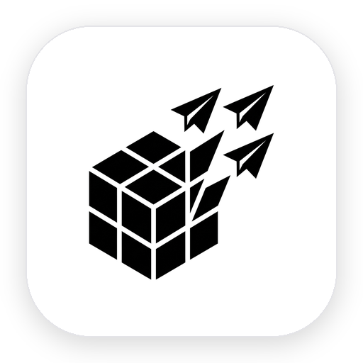

<p align="center">
  
</p>

<p align="center">
  
</p>

<p align="center">
  <strong>Biến mọi tài khoản Google Colab + GPU máy bạn thành một dàn render Blender trực tiếp. Chỉ cần chạy <code>blendfleet fly</code>.</strong>
</p>

<p align="center">
  <a href="https://github.com/brixtonpham/blendfleet/releases"></a>
  <a href="https://www.python.org/"></a>
  <a href="LICENSE"></a>
  <a href="pyproject.toml"></a>
  <a href="https://colab.research.google.com/github/brixtonpham/blendfleet/blob/main/notebooks/blendfleet_worker.ipynb"></a>
</p>

<p align="center">
  <a href="README.md">English</a> | <strong>Tiếng Việt</strong> | <a href="README.zh-CN.md">简体中文</a>
</p>

<p align="center">
  <strong>blendfleet</strong> gộp GPU Google Colab miễn phí hoặc trả phí (<code>T4</code>, <code>L4</code>, <code>G4</code>), GPU Kaggle và máy cục bộ Apple Silicon hoặc NVIDIA thành một cụm render <code>bpy</code> tự động chia tải (work-stealing).<br />
  Đăng nhập một lần cho mỗi tài khoản Google, sau đó chạy render đa GPU hoàn toàn từ terminal — không khởi động lại Blender từng frame, không phụ thuộc thư viện lõi bên ngoài.
</p>

---

## Cài đặt

```bash
# 1. Cài CLI lõi (0 thư viện Python bên ngoài)
uv tool install git+https://github.com/brixtonpham/blendfleet.git

# 2. Tùy chọn: chạy dàn Colab đa tài khoản headless + tunnel
uv tool install google-colab-cli && brew install cloudflared

# 3. Tùy chọn: cài Agent Skill chính thức (Claude Code / Cursor / Codex / Antigravity)
npx skills add brixtonpham/blendfleet
```

<details>
<summary>Cài đặt thay thế bằng <code>pip</code></summary>

```bash
pip install git+https://github.com/brixtonpham/blendfleet.git
```

</details>

---

## Đăng nhập 1 lần → Render không giới hạn

Thêm bao nhiêu tài khoản Google tùy thích — mỗi tài khoản chỉ cần đăng nhập 1 lần duy nhất, không cần copy-paste mã (OAuth PKCE loopback tự động chuyển hướng về máy). Thông tin đăng nhập lưu cục bộ tại `~/.config/blendfleet/accounts/` với quyền `0600`, và mọi lần render sau chạy hoàn toàn từ terminal mà không cần mở tab trình duyệt.

### 1. Thêm tài khoản Google

```bash
# Liệt kê các profile Chrome trên máy (tùy chọn)
blendfleet account chrome-profiles

# Đăng nhập từng tài khoản một lần (mở đúng profile Chrome — chỉ cần bấm Allow)
blendfleet account add acc1 --chrome-profile "Profile 1"
blendfleet account add acc2 --chrome-profile "Profile 2"
blendfleet account add acc3 --chrome-profile "Profile 3"
```

### 2. Kiểm tra tài khoản & số dư CCU song song

```bash
blendfleet account check
```

Kiểm tra đồng thời email, trạng thái token và số dư Colab Compute Units (CCU) của toàn bộ tài khoản trước khi render.

### 3. Khởi chạy toàn bộ dàn GPU bằng một lệnh

```bash
blendfleet fly scene.blend \
  --frames 1-240 \
  --out ./out \
  --accounts all \
  --gpu T4 \
  --local-workers 1 \
  --stitch-out final.mp4
```

`blendfleet fly` tự động thực hiện trọn gói:
1. Mở HTTP coordinator chia tải trên máy cục bộ kèm `cloudflared` Quick Tunnel cô lập (`--config /dev/null`, không đụng với `~/.cloudflared/config.yml` sẵn có), bảo vệ bằng bearer token dùng một lần và kiểm tra `/health` thông suốt trước khi khởi tạo GPU.
2. Khởi tạo runtime GPU Colab headless trên toàn bộ tài khoản đã chọn (`--accounts all` hoặc `--accounts acc1,acc2`) và gắn thêm GPU máy cục bộ (`--local-workers 1`).
3. Truyền `scene.blend` đúng 1 lần cho mỗi worker, giữ một tiến trình `bpy` chạy liên tục trên mỗi GPU, tự thu hồi frame nếu một VM Colab ngắt kết nối, kiểm tra header PNG/EXR nguyên tử, tắt sạch VM Colab khi xong và ghép `final.mp4` bằng FFmpeg tăng tốc phần cứng.

---

## Agent Skill

`blendfleet` đi kèm Agent Skill chính thức tại [`skills/blendfleet/SKILL.md`](skills/blendfleet/SKILL.md) cho Claude Code, Antigravity, Codex, OpenCode và Cursor.

### Cài đặt Skill

```bash
# Cài chuẩn cho mọi agent (Claude Code, Cursor, Codex, Antigravity, OpenCode)
npx skills add brixtonpham/blendfleet

# Hoặc bằng ccp (https://github.com/samhvw8/claude-code-profile)
ccp install https://github.com/brixtonpham/blendfleet --all --link .

# Hoặc sao chép trực tiếp vào thư mục skills của agent
git clone --depth 1 https://github.com/brixtonpham/blendfleet.git ~/.cache/blendfleet-repo \
  && cp -R ~/.cache/blendfleet-repo/skills/blendfleet ~/.claude/skills/blendfleet \
  && rm -rf ~/.cache/blendfleet-repo
```

### Ví dụ câu lệnh cho Agent

- *"Kiểm tra số dư CCU các tài khoản Colab trong blendfleet, rồi render frame 1–240 của `shot_03.blend` trên tất cả T4 miễn phí cộng thêm máy Mac của tôi và xuất MP4 24fps."*
- *"Liệt kê các profile Chrome của tôi, hướng dẫn thêm 3 tài khoản Google vào blendfleet và kiểm tra kết nối."*
- *"Kiểm tra thư mục `./renders/shot_03` xem đủ 240 frame chưa, render lại các frame thiếu trên Colab L4 rồi ghép `shot_03.mp4`."*

---

## Cơ chế hoạt động

```text
                      ┌──────────────────────────────────────────┐
                      │      blendfleet fly / serve --tunnel     │
                      │  • Gửi .blend 1 lần (cache SHA-256)      │
                      │  • Cấp lease từng frame + heartbeat      │
                      │  • Tự thu hồi frame khi VM ngắt kết nối  │
                      │  • Kiểm tra PNG/EXR nguyên tử -> ./out   │
                      │  • Tự động ghép MP4 khi hoàn tất         │
                      └──────┬─────────────┬─────────────┬───────┘
                             │             │             │
                localhost    │   HTTPS     │   HTTPS     │   HTTPS
                             ▼             ▼             ▼
                   ┌──────────────┐ ┌────────────┐ ┌────────────┐
                   │ Local Worker │ │ Colab acc1 │ │ Colab 2..N │
                   │ Apple M3 Max │ │ Free T4    │ │ T4 / L4/G4 │
                   │ Metal RT     │ │ OptiX      │ │ OptiX      │
                   │ 1x bpy proc  │ │ 1x bpy proc│ │ 1x bpy proc│
                   └──────────────┘ └────────────┘ └────────────┘
```

### Nhanh hơn 8×–20× ở frame nóng (Không khởi động lại Blender từng frame)

Đo thực tế trên **Blender 5.2.3 LTS**:
- **Google Colab Free `Tesla T4` (`CYCLES/OPTIX`, 640×360, 16 samples):** frame 1 lạnh **`4.32s`** → các frame 2–4 nóng chỉ còn **`0.54s–0.67s`** (**nhanh hơn ~8×** trong cùng 1 tiến trình `bpy`).
- **Apple M3 Max cục bộ (`CYCLES/METAL`):** frame 1 lạnh **`1.44s–8.58s`** → frame nóng **`0.33s`** (giảm tới **20×** chi phí khởi động).

Mỗi worker chỉ mở Blender **đúng 1 lần** (`blender -b scene.blend -P blender_worker.py`), nên việc nạp `.blend`, giải nén texture và biên dịch shader OptiX/Metal chỉ chạy một lần duy nhất trên mỗi GPU.

### So sánh với các Notebook Blender Colab cũ

| Hạng mục | Notebook Colab truyền thống | `blendfleet` |
|---|---|---|
| Vòng đời tiến trình Blender | Mở lại `blender -b` mỗi frame (tốn `1.44s–8.58s`) | **Vòng lặp `bpy` thường trực** (`0.33s` M3 Max / `0.54s` Colab T4) |
| Chạy nhiều tài khoản | Mở thủ công nhiều tab + bấm cấp quyền Drive mỗi phiên | **Đăng nhập 1 lần (không copy-paste) → `blendfleet fly --accounts all`** |
| Phân bổ frame | Chia dải tĩnh (GPU mạnh xong trước ngồi chờ) | **Work-stealing động** với TTL lease + heartbeat |
| Xung đột khóa Google Drive | Lỗi tranh chấp file `.tmp` do độ trễ đồng bộ Drive 2–10s | **HTTP coordinator** (hoặc chia modulo 2 pha + `O_CREAT\|O_EXCL`) |
| Rớt kết nối / giới hạn 90 phút | Mất frame giữa chừng phải chạy bù thủ công | **Tự thu hồi lease hết hạn** + kiểm tra byte header PNG/EXR |
| Thư viện Python lõi | Cài nhiều gói dễ xung đột phiên bản sẵn trên Colab | **0 thư viện ngoài** (100% thư viện chuẩn Python) |

### Bảng chọn GPU cho Blender Cycles

Cycles tận dụng **nhân Ray Tracing phần cứng** (`OPTIX` / `METAL`), không dùng nhân Tensor:

| Phần cứng | Chi phí tham khảo | Backend | Khuyến nghị |
|---|---|---|---|
| **Apple M3 Max (Máy cục bộ)** | Miễn phí | `METAL` (Metal RT) | Nhanh hơn ~2.8× so với 1 Colab `T4` — chạy kèm `--local-workers 1`. |
| **Colab `T4` (16 GB)** | Miễn phí (0 CCU) | `OPTIX` (Turing RT) | Rất tốt khi gộp nhiều tài khoản (`blendfleet` không giới hạn số tài khoản) hoặc muốn giữ trống RAM/GPU máy cá nhân. |
| **Colab `L4` (24 GB)** | ~1.71 CCU/giờ | `OPTIX` (Ada RT) | Hiệu quả CCU cao nhất (~580 giờ cho mỗi 1.000 CCU). |
| **Colab `G4` (96 GB)** | ~8.8 CCU/giờ | `OPTIX` (Blackwell RT) | Tốt nhất cho cảnh 4K nặng / tốn VRAM (~3.5× nhanh hơn M3 Max). |
| **Colab `A100` / `H100`** | 5.4–18.0 CCU/giờ | Chỉ `CUDA` (**không có nhân RT**) | **Nên tránh cho Cycles** — hiệu năng ray-tracing trên mỗi CCU rất thấp. |

Các máy ảo Colab Linux còn tự động nạp sẵn `libtcmalloc_minimal` để tránh lỗi tràn bộ nhớ allocator glibc khi render chuỗi dài.

---

## Chế độ Google Drive chia sẻ không cần server & Notebook độc lập

### Chế độ Shared Drive / NFS (`--mode fs`)

Không muốn mở HTTP tunnel? Chia sẻ một thư mục Google Drive cho $N$ tài khoản Colab/Kaggle và truyền `--worker-index 0 .. N-1`:

```bash
# Tài khoản 0 (tài khoản 1..3 truyền --worker-index 1, 2, 3)
blendfleet worker --mode fs \
  --scene /content/drive/MyDrive/blendfleet_job/scene.blend \
  --out /content/drive/MyDrive/blendfleet_job/frames \
  --frames 1-240 --worker-index 0 --total-workers 4
```

Mỗi worker chép `scene.blend` vào ổ NVMe `/content/` cục bộ, render trước phần modulo rời nhau (`frame % N == worker_index`, loại bỏ tranh chấp Drive FUSE), sau đó tự động quét đuôi bằng khóa nguyên tử `O_CREAT | O_EXCL` để render bù các frame còn sót lại từ worker bị ngắt sớm.

### Chạy Coordinator thủ công + Notebook độc lập

Bạn cũng có thể khởi chạy coordinator thủ công rồi dán ô code in sẵn vào [`notebooks/blendfleet_worker.ipynb`](notebooks/blendfleet_worker.ipynb) (Colab hoặc Kaggle):

```bash
blendfleet serve scene.blend --frames 1-240 --out ./out --local-workers 1 --tunnel --stitch-out final.mp4
```

### Kiểm tra & Ghép video bất cứ lúc nào

```bash
blendfleet verify ./out --frames 1-240
blendfleet stitch ./out --frames 1-240 --fps 24 --out final.mp4
```

---

## Phát triển

```bash
mise run setup      # cài môi trường dev & test bằng uv
mise run test       # chạy unit test và integration test đa worker
mise run e2e-local  # chạy smoke test Blender headless 2 worker + FFmpeg thật
mise run check      # kiểm tra ruff lint + pytest + OKF
```

Xem thêm [CONTRIBUTING.md](CONTRIBUTING.md) để nắm nguyên tắc kiến trúc và quy trình gửi PR.

---

## Nguồn cảm hứng & Dự án tiền nhiệm

- [`ynshung/blender-colab`](https://github.com/ynshung/blender-colab) — kỹ thuật nạp sẵn `libtcmalloc` và mirror dự phòng Blender (`ftp.nluug.nl`).
- [`cgmaniac/blender-colab-render-suite`](https://github.com/cgmaniac/blender-colab-render-suite) — staging lên NVMe cục bộ, cú pháp dải frame và ghép gamma Linear EXR.
- [`sufianahamd/Blender-Multi-Account-Rendering`](https://github.com/sufianahamd/Blender-Multi-Account-Rendering) — mô hình render đa tài khoản qua thư mục chia sẻ (nâng cấp thành `bpy` thường trực + khóa nguyên tử).
- [`googlecolab/google-colab-cli`](https://github.com/googlecolab/google-colab-cli) — khởi tạo runtime Colab headless từ dòng lệnh.
- [`googlecolab/colab-mcp`](https://github.com/googlecolab/colab-mcp) — cầu nối WebSocket trình duyệt (nâng cấp cấp phát cổng dual-stack IPv4+IPv6).
- [`MUKILAN0608/ColabCluster`](https://github.com/MUKILAN0608/ColabCluster) — mô hình heartbeat và thu hồi lease cho runtime Colab ngắn hạn.

## Giấy phép

[MIT](LICENSE)
