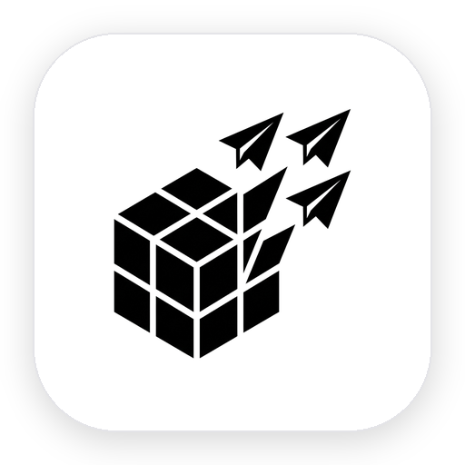

<p align="center">
  
</p>

<p align="center">
  
</p>

<p align="center">
  <strong>将你所有的 Google Colab 账号 + 本地显卡聚合成一台实时 Blender GPU 渲染集群。只需运行 <code>blendfleet fly</code>。</strong>
</p>

<p align="center">
  <a href="https://github.com/brixtonpham/blendfleet/releases"></a>
  <a href="https://www.python.org/"></a>
  <a href="LICENSE"></a>
  <a href="pyproject.toml"></a>
  <a href="https://colab.research.google.com/github/brixtonpham/blendfleet/blob/main/notebooks/blendfleet_worker.ipynb"></a>
</p>

<p align="center">
  <a href="README.md">English</a> | <a href="README.vi.md">Tiếng Việt</a> | <strong>简体中文</strong>
</p>

<p align="center">
  <strong>blendfleet</strong> 将免费或付费的 Google Colab GPU（<code>T4</code>、<code>L4</code>、<code>G4</code>）、Kaggle GPU 与本地 Apple Silicon 或 NVIDIA 显卡接入同一个常驻 <code>bpy</code> 工作窃取渲染池。<br />
  每个 Google 账号只需登录一次，即可在终端无头调度多 GPU 渲染——彻底告别逐帧重启 Blender，核心运行时零外部依赖。
</p>

---

## 安装

```bash
# 1. 核心 CLI（零外部 Python 依赖）
uv tool install git+https://github.com/brixtonpham/blendfleet.git

# 2. 可选：多账号无头 Colab 集群 + 隧道组件
uv tool install google-colab-cli && brew install cloudflared

# 3. 可选：安装官方 Agent Skill（Claude Code / Cursor / Codex / Antigravity）
npx skills add brixtonpham/blendfleet
```

<details>
<summary>使用 <code>pip</code> 安装</summary>

```bash
pip install git+https://github.com/brixtonpham/blendfleet.git
```

</details>

---

## 登录一次 → 随时起飞

可按需绑定任意数量的 Google 账号——每个账号仅需授权一次，全程无需手动复制粘贴验证码（本地 PKCE loopback OAuth 自动回跳）。凭据以 `0600` 权限保存在 `~/.config/blendfleet/accounts/`，之后即可在终端无头调度多账号 Colab GPU，无需保留浏览器标签页。

### 1. 一次性绑定 Google 账号

```bash
# 查看本地 Chrome 配置文件（可选）
blendfleet account chrome-profiles

# 逐个授权账号（自动打开对应 Chrome 配置文件，点击允许即可自动完成）
blendfleet account add acc1 --chrome-profile "Profile 1"
blendfleet account add acc2 --chrome-profile "Profile 2"
blendfleet account add acc3 --chrome-profile "Profile 3"
```

### 2. 并行检查所有账号与 CCU 余额

```bash
blendfleet account check
```

在开始渲染前并行验证每个账号的邮箱、令牌有效性与可用 Colab 计算单元（CCU）。

### 3. 一条命令启动集群渲染

```bash
blendfleet fly scene.blend \
  --frames 1-240 \
  --out ./out \
  --accounts all \
  --gpu T4 \
  --local-workers 1 \
  --stitch-out final.mp4
```

`blendfleet fly` 会自动完成全部流程：
1. 在本地启动 HTTP 工作窃取协调器，通过隔离模式（`--config /dev/null`，不干扰现有 `~/.cloudflared/config.yml`）打开带一次性 Bearer Token 的 `cloudflared` Quick Tunnel，并先确认 `/health` 可达再分配云端 GPU。
2. 为每个选定账号（`--accounts all` 或 `--accounts acc1,acc2`）无头拉起 Colab GPU 实例，并同时挂载本地 GPU（`--local-workers 1`）。
3. 每个节点仅传输一次 `scene.blend`，在单 GPU 上维持常驻 `bpy` 进程连续出帧；任意 Colab 实例断线时自动回收帧租约；写入前原子校验 PNG/EXR 文件头；结束后自动释放 Colab 实例并调用硬件加速 FFmpeg 合成 `final.mp4`。

---

## Agent Skill

`blendfleet` 内置官方 Agent Skill（[`skills/blendfleet/SKILL.md`](skills/blendfleet/SKILL.md)），适配 Claude Code、Antigravity、Codex、OpenCode 与 Cursor。

### 安装 Skill

```bash
# 通用安装方式（Claude Code、Cursor、Codex、Antigravity、OpenCode）
npx skills add brixtonpham/blendfleet

# 或使用 ccp（https://github.com/samhvw8/claude-code-profile）
ccp install https://github.com/brixtonpham/blendfleet --all --link .

# 或手动复制到 Agent 的 skills 目录
git clone --depth 1 https://github.com/brixtonpham/blendfleet.git ~/.cache/blendfleet-repo \
  && cp -R ~/.cache/blendfleet-repo/skills/blendfleet ~/.claude/skills/blendfleet \
  && rm -rf ~/.cache/blendfleet-repo
```

### 自然语言提示示例

- *“检查我 blendfleet 里所有 Colab 账号的 CCU 余额，用所有免费 T4 加上我的 Mac 渲染 `shot_03.blend` 的 1–240 帧，并按 24fps 合成 MP4。”*
- *“列出我的 Chrome 配置文件，引导我把 3 个 Google 账号添加到 blendfleet 并验证连通性。”*
- *“校验 `./renders/shot_03` 的 240 帧是否完整，缺失的帧用 Colab L4 补渲，然后合成 `shot_03.mp4`。”*

---

## 工作原理

```text
                      ┌──────────────────────────────────────────┐
                      │      blendfleet fly / serve --tunnel     │
                      │  • 仅分发一次 .blend（SHA-256 缓存）      │
                      │  • 动态帧租约 + 心跳续期                  │
                      │  • 节点掉线后自动回收未完成帧              │
                      │  • PNG/EXR 原子校验落盘 -> ./out          │
                      │  • 全部完成后自动合成 MP4                 │
                      └──────┬─────────────┬─────────────┬───────┘
                             │             │             │
                localhost    │   HTTPS     │   HTTPS     │   HTTPS
                             ▼             ▼             ▼
                   ┌──────────────┐ ┌────────────┐ ┌────────────┐
                   │ Local Worker │ │ Colab acc1 │ │ Colab 2..N │
                   │ Apple M3 Max │ │ Free T4    │ │ T4 / L4/G4 │
                   │ Metal RT     │ │ OptiX      │ │ OptiX      │
                   │ 1x bpy proc  │ │ 1x bpy proc│ │ 1x bpy proc│
                   └──────────────┘ └────────────┘ └────────────┘
```

### 热帧提速 8×–20×（告别逐帧重启 Blender）

在 **Blender 5.2.3 LTS** 上的真实云端与本地实测数据：
- **Google Colab 免费 `Tesla T4`（`CYCLES/OPTIX`，640×360，16 samples）：** 第 1 帧冷启动 **`4.32s`** → 第 2–4 帧热帧仅 **`0.54s–0.67s`**（常驻 `bpy` 进程提速 **~8×**）。
- **本地 Apple M3 Max（`CYCLES/METAL`）：** 第 1 帧冷启动 **`1.44s–8.58s`** → 热帧 **`0.33s`**（最高降低 **20×** 帧间额外开销）。

每个工作节点只启动**一次** Blender（`blender -b scene.blend -P blender_worker.py`），`.blend` 加载、贴图解包与 OptiX/Metal 着色器编译每卡仅执行一次。

### 与传统 Colab Blender Notebook 对比

| 维度 | 传统 Colab Notebook | `blendfleet` |
|---|---|---|
| Blender 进程模型 | 每帧重启 `blender -b`（`1.44s–8.58s` 开销） | **常驻 `bpy` 循环**（M3 Max `0.33s` / Colab T4 `0.54s` 热帧） |
| 多账号调度 | 每次手动开多标签页 + 逐个点击 Drive OAuth | **登录一次（免复制粘贴）→ `blendfleet fly --accounts all`** |
| 帧分配策略 | 静态切分帧段（快卡提前完工干等） | **动态工作窃取** + TTL 租约与心跳 |
| 共享网盘锁冲突 | Drive FUSE 2–10 秒同步延迟导致 `.tmp` 竞态 | **HTTP 协调器**（或两阶段取模 + `O_CREAT\|O_EXCL`） |
| 断连 / 90 分钟超时 | 丢帧需人工排查补渲 | **过期租约自动回收** + PNG/EXR 魔数原子校验 |
| 核心 Python 依赖 | 安装大量依赖易与 Colab 预装包冲突 | **0 外部依赖**（100% Python 标准库核心） |

### Blender Cycles GPU 选型矩阵

Blender Cycles 依赖的是**硬件光线追踪核心**（`OPTIX` / `METAL`），而非 Tensor 核心：

| 算力节点 | 典型成本 | 渲染后端 | 选型建议 |
|---|---|---|---|
| **Apple M3 Max（本地）** | 免费 | `METAL`（Metal RT） | 速度约为单卡 Colab `T4` 的 2.8×，建议配合 `--local-workers 1` 混跑。 |
| **Colab `T4` (16 GB)** | 免费（0 CCU） | `OPTIX`（Turing RT） | 适合聚合多个免费账号（`blendfleet` 不限制账号数量），或用于释放本地内存与显卡。 |
| **Colab `L4` (24 GB)** | ~1.71 CCU/小时 | `OPTIX`（Ada RT） | CCU 性价比最高（每 1,000 CCU 约可跑 580 小时）。 |
| **Colab `G4` (96 GB)** | ~8.8 CCU/小时 | `OPTIX`（Blackwell RT） | 适合重度 4K / 高显存场景（约为 M3 Max 的 3.5×）。 |
| **Colab `A100` / `H100`** | 5.4–18.0 CCU/小时 | 仅 `CUDA`（**无 RT 核心**） | **不建议用于 Cycles**——单位 CCU 光追性价比极低。 |

Linux Colab 实例还会自动预加载 `libtcmalloc_minimal`，防止长序列渲染中 glibc 内存分配器触发 OOM 崩溃。

---

## 零服务端 Google Drive 共享模式与独立 Notebook

### Google Drive / NFS 共享目录模式（`--mode fs`）

不想使用 HTTP 隧道？只需将同一个 Google Drive 目录共享给 $N$ 个 Colab 或 Kaggle 账号，并分配 `--worker-index 0 .. N-1`：

```bash
# 账号 0（账号 1..3 分别传入 --worker-index 1, 2, 3）
blendfleet worker --mode fs \
  --scene /content/drive/MyDrive/blendfleet_job/scene.blend \
  --out /content/drive/MyDrive/blendfleet_job/frames \
  --frames 1-240 --worker-index 0 --total-workers 4
```

每个节点先将 `scene.blend` 缓存至本地 `/content/` NVMe，第一阶段仅渲染互不重叠的取模分片（`frame % N == worker_index`，彻底消除 Drive FUSE 锁竞争），第二阶段再通过原子 `O_CREAT | O_EXCL` 扫尾接管提前掉线节点的剩余帧。

### 手动协调器 + 独立 Notebook

也可以手动启动协调器，将终端输出的单格代码粘贴到 [`notebooks/blendfleet_worker.ipynb`](notebooks/blendfleet_worker.ipynb)（支持 Colab 与 Kaggle）：

```bash
blendfleet serve scene.blend --frames 1-240 --out ./out --local-workers 1 --tunnel --stitch-out final.mp4
```

### 随时校验与合成视频

```bash
blendfleet verify ./out --frames 1-240
blendfleet stitch ./out --frames 1-240 --fps 24 --out final.mp4
```

---

## 开发指南

```bash
mise run setup      # 使用 uv 安装开发与测试依赖
mise run test       # 运行单元测试与多节点集成测试
mise run e2e-local  # 运行真实双节点无头 Blender + FFmpeg 冒烟测试
mise run check      # 执行 ruff 代码检查 + pytest + OKF 校验
```

架构约束与 PR 规范请阅读 [CONTRIBUTING.md](CONTRIBUTING.md)。

---

## 灵感与前人工作

- [`ynshung/blender-colab`](https://github.com/ynshung/blender-colab) — `libtcmalloc` 预加载与 Blender 官方镜像回退（`ftp.nluug.nl`）。
- [`cgmaniac/blender-colab-render-suite`](https://github.com/cgmaniac/blender-colab-render-suite) — 本地 NVMe 暂存、帧范围表达式与 Linear EXR 伽马合成。
- [`sufianahamd/Blender-Multi-Account-Rendering`](https://github.com/sufianahamd/Blender-Multi-Account-Rendering) — 多账号共享目录渲染思路（本项目升级为常驻 `bpy` 与原子租约）。
- [`googlecolab/google-colab-cli`](https://github.com/googlecolab/google-colab-cli) — 终端无头拉起 Colab 运行时。
- [`googlecolab/colab-mcp`](https://github.com/googlecolab/colab-mcp) — 浏览器 WebSocket 桥接（本项目升级为 IPv4+IPv6 双栈端口预分配）。
- [`MUKILAN0608/ColabCluster`](https://github.com/MUKILAN0608/ColabCluster) — 针对短生命周期 Colab 实例的心跳与租约回收模型。

## 许可证

[MIT](LICENSE)
